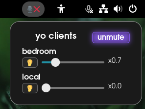

# **yo-gnome-shell-extension**

[ "")](https://github.com/sponsors/QuackHack-McBlindy) [](https://buymeacoffee.com/quackhackmcblindy)

<br>




**This  is a GNOME desktop widget for <a href="https://github.com/QuackHack-McBlindy/yo">yo</a>.**

This widget let's users control their clients microphone gain, mute/unmute and also output their microphone on the users speakers.<br> 


<br>
<br>

## **Installation**


```bash
git clone https://github.com/QuackHack-McBlindy/yo-gnome-shell-extension.git
cd yo-gnome-shell-extension
bash install.sh
```

<br>

## **License**

This project is licensed under the terms of the MIT license.<br>
See the `LICENSE` file in the repository for full details.<br>

Contributions are welcomed.

